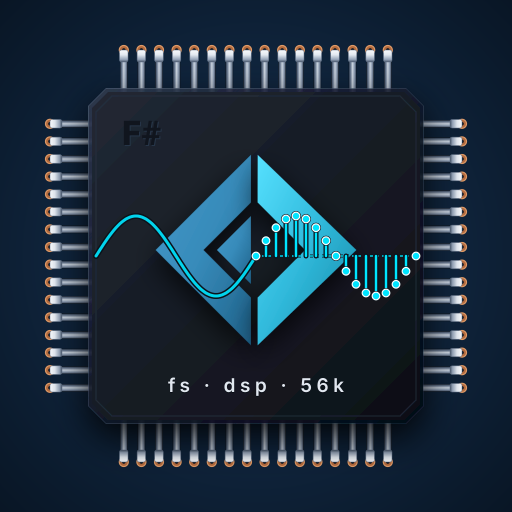

# fsdsp56k

F# tooling for the Motorola DSP56300 family, and on top of it, a workflow for writing Elektron
Machinedrum machines: MDS packages for X.20, the MDX custom firmware.

Writing a machine for the Machinedrum's DSP usually starts and ends in hand-written assembly: you
write it, assemble it with Motorola's `asm56300`, pack it with the MDS tools, send it over SysEx,
and listen. The MDS standard asks you to measure each machine's worst-case cycles in a simulator
before you declare them, but it doesn't ship one. That is a long way to go before you hear whether
an idea is any good.

fsdsp56k shortens that loop. You can prototype a machine in F# and run it as ordinary code: test
it, step through it in a debugger, and save the words it renders as a WAV with one call
(`Audio.writeWav`), with no emulator and no hardware. The prototype runs natively on .NET, and
[Fable](https://fable.io) compiles the same functions to JavaScript and to Rust (native or
WebAssembly, down to a browser AudioWorklet); we have used both. When the idea is worth it, the
same code compiles to DSP56300 assembly that you can audition and render (the DSP56300 runs it
with an MDS-style workset), and it is checked word for word against the prototype. Only then do you need to spend effort on hand optimisation and on
the real machine.

Some questions, if this kind of DSP work interests you:

- Ready to write 100% hand assembly from day one, or would you rather hear an idea before you count cycles?
- Would you like to know that your optimised version still produces the same words as the version you understood?
- Want to see, line by line, which F# turned into which instruction, and where the cycles go?
- Would a set of real, shipped machines as a regression suite make you braver about changing things?

If some of these are yes, this is what fsdsp56k gives you:

- **An F# prototype.** A machine is a module of three functions (`init`, `trig`, `render`) over
  fixed-point types that behave like the DSP's own arithmetic.
- **A prototype that runs where you work.** The same functions run natively on .NET
  (`Host.Instance`), the meaning the compiled program is held to, and through Fable as JavaScript
  and Rust, checked word for word against it ([portable](portable/README.md)). Fable's Python
  target should work too, but we haven't tested it.
- **A grade against the emulator.** The compiled program runs on the DSP56300 emulator
  (mborgerson/dsp56300) with an MDS-style workset, and its output and state are compared word for word with the
  prototype and, for ported machines, with the shipped original. Every call's cycles are measured
  against the per-track limit.
- **An optimizer.** The compiler's passes trim reloads and spills, keep hot values in registers
  and pack parallel moves. On the fixture machines we grade, the compiled code takes about 1.4 to
  2.8 times the RENDER cycles of the hand-written originals, and there is a lot of room to improve.
  Hand optimisation still pays; you just do it later, and only where it matters.
- **MDS packages.** The compiled program becomes an MDS package with its relocations and imports.
  For hand-written machines, the `fsdsp56k` command line assembles Motorola-syntax source, checks
  each instruction against the dsp56300 oracle, packs it with the same JSON definition `mds_pack.py`
  reads, converts packages to and from SysEx, disassembles them, and runs them on the emulator with
  a WAV and a cycle report.
- **Assembly as F#.** When you want to write the instructions yourself, the DSL writes them as F#
  values: a routine becomes a function you can parameterise, unroll with a loop and share between
  machines, and it prints as Motorola syntax for `asm56300`.
- **A real test suite.** All eight drums of kitbasher's TX6 kit and Justin Mammarella's four MDS examples are
  ported and graded on every test run, each identical, word for word, to the machine it was ported from.

You can also skip the kernel layer and write the assembly yourself, in F#. Plain assembly shares
code through `include`, `equ`, `define` and conditional assembly, and it does that well: in the MDS
sample-playback examples, four machines are each a few `equ` lines over one shared
`sample_player.inc`, whose `if REVERSE` and `if BANK_ID<0` blocks pick the code each one needs. The
DSL writes DSP56300 programs as F# arrays of instructions, so the same ideas become ordinary F#: a
routine is a function of its labels, offsets and counts, a `for` loop unrolls it, and an `if`
chooses its shape when the program is built.

```fsharp
open dsp56k.dsl
open dsp56k.dsl.Asm

/// Clear `count` Y words from (r6+first): unrolled when short, a DO loop when long.
let clearY name first count = [|
  label name
  clr a
  if count <= 4 then
    for i in 0 .. count - 1 do
      move a (ym (disp r6 (first + i)))
  else
    move r6 r0
    move (imm first) n0
    update (incN r0)
    doTo (imm count) $"{name}_end"
    move a (ym (inc r0))
    label $"{name}_end"
  rts |]

let program = Array.concat [ clearY "INIT" 9 19; clearY "TRIG" 12 3 ]
let listing = Program.source program   // INIT as a DO loop, TRIG as three moves
let words   = Program.words program    // 13 P words
```

The assembler, disassembler and emulator work on any DSP56300 code, whether it was written this way
or by hand.

fsdsp56k is free software under the GNU Affero General Public License, version 3 or any later version
(AGPL-3.0-or-later): see [LICENSE](LICENSE) and [Licence](#licence).

## Credits

fsdsp56k stands on other people's work, and we are grateful for all of it.

- **Motorola**, the house of the 68000, for the DSP56000 family (1986), designed to stay close
  enough to Motorola's microprocessors to be easy to learn, and its DSP56300 generation; and for
  `asm56300` and its CLD/LOD tooling, whose dialect and sizing rules our assembler follows. The
  line passed to Freescale in 2004 and to NXP in 2015, whose Symphony Studio still supports
  DSP56300 development.
- **Elektron**, for the Machinedrum and its original firmware. MDS follows that firmware's machine
  design, and MDX extends it by patching, which is what lets a Machinedrum run MDS machines today.
- **Justin Mammarella and Yatao Li**, for [MDX](https://github.com/jmamma/MDX), the custom
  Machinedrum firmware. X.20, its 2.0 preview, adds user machines.
- **Justin Mammarella**, for [MDS](https://github.com/jmamma/MDS): the machine standard, its tools
  and its example machines. The JSON that `fsdsp56k machinedrum pack` reads is the one `mds_pack.py`
  reads, and four of the examples are part of our test suite.
- **[The Usual Suspects](https://dsp56300.com)**, for [dsp56300](https://github.com/dsp56300/dsp56300)
  (GPL-3.0), their DSP56300 emulator, public since 2021 and grown from code first written in 2011.
  Years of patient work went into it, and it is the heart of their emulations. The optional
  WebAssembly build compiles The Usual Suspects' dsp56300 interpreter for playback in the browser.
- **Matt Borgerson**, for [dsp56300](https://github.com/mborgerson/dsp56300) (MIT), a separate
  DSP56300 toolkit in Rust: an assembler, a disassembler and a JIT emulator, which also runs the DSP
  cores of the original Xbox's audio processor in [xemu](https://xemu.app), and is checked against
  real hardware. fsdsp56k uses it natively as the instruction oracle, as the assembler and
  disassembler its own are checked against, and as the emulator behind `run`, `stress`, `audition`
  and every grade.
- **Matthew Fecher (AnalogMatthew) and Fadedlimes**, for the TX6 drum kit in
  [kitbasher](https://github.com/etcetc000/kitbasher). Its DSP sources are MIT-licensed, and all
  eight drums are ported and graded here.

## Commands

DSP56300 commands work on any code for the chip; a host's commands live under its name (today the
Machinedrum: `machinedrum`, or `md`). `run`, `stress` and `audition` take a machine for a host
(`--host`, default `machinedrum`): an MDS package or SysEx dump, or an F# kernel as a project, a
script or one file (`--kernel` picks one when it defines several). `grade` takes an F# kernel. With
a script or a file, `--define NAME` sets a conditional compilation symbol (repeatable), so
`#if HAND_SHAPE` picks what is built. `fsdsp56k <command> --help` lists every flag; from a clone,
`dotnet run --project src/dsp56k.tool -- <command>`.

| | Command | What it does |
|---|---|---|
| 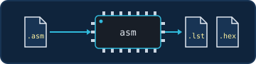 | `asm` | Assemble a Motorola-syntax source to a listing and P-memory hex. |
| 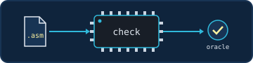 | `check` | Assemble, then confirm every instruction against the dsp56300 oracle. |
| 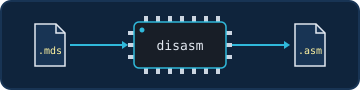 | `disasm` | Recover a package's program (from a .mds or .syx) as Motorola-syntax source. |
| 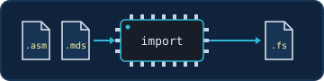 | `import` | Turn a listing or a package into F# DSL source. |
| 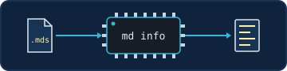 | `machinedrum info` | Show a package's header, parameters, patches and checks. |
| 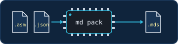 | `machinedrum pack` | Assemble a program and pack it with its MDS JSON definition (and an optional sprite). |
| 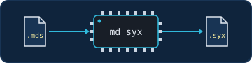 | `machinedrum syx` | Turn a package into a SysEx dump for a slot. |
| 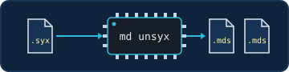 | `machinedrum unsyx` | Split a SysEx dump back into packages. |
| 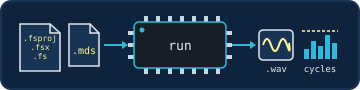 | `run` | Render a machine: a 24-bit WAV, per-call cycles against the limit, and `--profile` hot spots. |
| 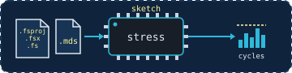 | `stress` *(sketch)* | Sweep the parameters (`--sweep exhaustive`, `random:N`) or search for the worst case (`--search anneal:N`), and report the worst INIT, TRIG and RENDER cycles with the settings that cause them, each case's output peak and RMS, and the cases whose calls did not return; `--phase peak` or `rms` searches for the loudest settings instead, and `--audition` plays each case as it goes. |
| 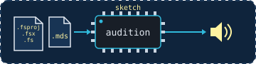 | `audition` *(sketch)* | Play a machine live through the sound card, retriggered with `--trig-every`. |
| | `grade` | Compile an F# kernel, run it on the emulator and as .NET code, and compare output and state word for word, with its costs; then each hand-written helper, in the kernel and on its own. Exit code 1 when anything differs; `--listing` writes the program as Motorola-syntax source. |
| 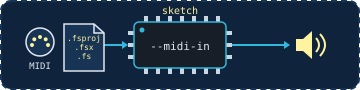 | `audition --midi-in` *(sketch)* | Trigger it and turn its parameters from a MIDI controller, in the Machinedrum's default map; `--midi-out` mirrors it to a real Machinedrum or other gear. |

## Layers

The DSP56300 libraries know nothing about the Machinedrum; the Machinedrum libraries build on
them; samples and the command-line tool sit on top.

| Path | What it is |
|---|---|
| **Pure DSP56300** | |
| `src/dsp56k` | Typed ISA, encoder, Motorola-syntax printer and parser, two-pass assembler (`include`, `define`, `macro`, `if`) with asm56300's sizing rule |
| `src/dsp56k.dsl` | The F# DSL: instruction helpers (`move`, `mac`, `doTo`, `brclr`…), workset layouts, table generation, optional lowering passes (parallel-move packing, AGU hazards), transcription of items to DSL source, listing import |
| `src/dsp56k.native` | P/Invoke over `native/`: the oracle assembler/disassembler, the JIT emulator (run, call, profile), program recovery from words |
| `native` | Rust `cdylib` with a C ABI over mborgerson/dsp56300 (MIT), pinned |
| **Machinedrum MDS** | |
| `src/machinedrum` | MDS v1 packages (JSON definitions, byte-exact writer, reader, verification), the machine ABI as DSL helpers (workset, resources, services, patch markers), SysEx dumps |
| `src/machinedrum.run` | A track on the emulator (loader relocation and imports, the program mirrored in X as X aliases P, the track memory kept clear of the program, parameter conversion, sample-service stand-ins, cycle budgets), WAV I/O, binary import of packages to DSL items |
| **Kernel F#** | |
| `src/dsp56k.kernel.intrinsics` | `Frac`, `Acc`, `Long`, `Table`, `Output`: DSP56300 arithmetic as .NET code, each operation tagged with the compiler's intrinsic name |
| `src/dsp56k.kernel` | The kernel compiler: a front end over the F# compiler's typed tree of the kernel's source, the `IrKernel`, the code generator and the optimizer passes, to DSL items; and a .NET host running the same kernel |
| `src/dsp56k.kernel.grade` | Runs a scenario three ways (.NET kernel, compiled program, reference) on a harness (the MDS track, or a program image of your own loaded at fixed addresses) and reports correctness, fidelity, cost and listing alignment |
| `portable` | Opt-in direct F# execution: .NET, Fable JavaScript, Fable Rust/WASM; exact sample checks and render timing ([usage](portable/README.md)) |
| **On top** | |
| `src/dsp56k.tool` | The `fsdsp56k` command line |
| `samples` | DSL programs reproducing shipped machines word for word |
| `tests/dsp56k.tests` | Expecto tests |

## The DSL

A program is an array of items written with F# functions, so loops, tables and variants are
ordinary F# code:

```fsharp
open dsp56k.dsl
open dsp56k.dsl.Asm

let clearWorkset = [|
  label "init"
  move r6 r0
  move (imm 9) n0
  update (incN r0)
  clr a
  doTo (imm 19) "init_end"
  move a (ym (inc r0))
  label "init_end"
  rts |]

let words = Program.words clearWorkset        // assembled with the same encoder as listings
let listing = Program.source clearWorkset     // Motorola syntax, for asm56300 or review
```

## Kernels

A kernel is a Machinedrum machine written as ordinary F# over fixed-point types (`Frac`, `Acc`, `Long`).
The same code runs as a prototype, to hear and test it, and compiled to DSP56300 code that the
Machinedrum runs. The grade checks that both give the same words.

### From F# to a running machine

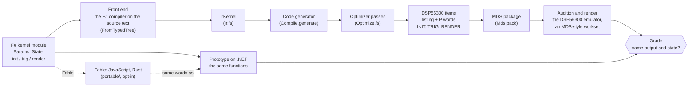

1. **Source.** You write a module with a parameter record, a state record and three functions.
2. **Front end.** The F# compiler reads the three functions from the source text, and the front end
   turns them into the compiler's own tree, the `IrKernel`.
3. **Code generator and optimizer.** The generator turns the tree into DSP56300 items. The
   optimizer passes then shorten it (fewer reloads and spills, registers for hot locals, parallel
   moves). A kernel too big for an MDS package is refused.
4. **Assembly and package.** The items assemble to P words with three entry symbols, `INIT`,
   `TRIG` and `RENDER`, and are packed as an MDS package with the machine's name and controls.
5. **Host and grade.** The DSP56300 emulator runs the package with an MDS-style workset, so you
   can audition and render it. The grade runs a scenario there, runs the same F# prototype on .NET, and compares output and state word for word,
   and against the shipped machine when there is one.

### The prototype beyond .NET

The kernel functions are plain F#, so [Fable](https://fable.io/docs/) can compile them too.
[`portable/`](portable/README.md) builds the same `init`, `trig` and `render` with Fable to
JavaScript and, with Fable's Rust backend, to Rust as WebAssembly and as a native library, and checks
each one's output and state after every block against the .NET run, the run the emulator is graded
against. SINE, PLUCK and INPUT-THRU pass on every target; the suite is opt-in and not part of the
default test run. `wasm/` plays the Rust/WebAssembly build in a browser AudioWorklet. Fable's
Python target should work the same way, but we haven't tried it.

### What a kernel declares

| Part | In the F# | On the Machinedrum |
|---|---|---|
| Entry points | `init`, `trig` and `render`, three functions of the kernel's module | `INIT` to set up, `TRIG` on each trig, `RENDER` once per 32-frame block |
| Parameters | a record of up to 8 `Frac` fields | Y:(r6+1) to Y:(r6+8), written by the host from the controls |
| Controls | not in the kernel: the machine definition names them (`PTCH`, `AMP`) | the front-panel knobs, 0 to 127, converted to the parameter words |
| State | a record of `Frac`, `Long`, `Acc` and `[<Length n>] Frac array` fields; `[<XMemory>]` puts a field in X | Y:(r6+9) on; X fields from X:(r6+0) |
| Output | `out.Write` in `render` | 32 mono words at Y:(r7)+ |
| Host | not in the kernel: `Kernel.hosts` (today only the Machinedrum) | where the words above sit and how the routines are called |

```mermaid
flowchart LR
  subgraph host["Machinedrum host, track t"]
    direction TB
    call["calls INIT, TRIG, RENDER<br/>with r6 = the track's workset"]
  end
  subgraph ws["the track's workset (64 words, r6-relative)"]
    direction TB
    yp["Y+1 .. Y+8: parameters"]
    ys["Y+9 .. Y+63: state"]
    x["X+0 .. X+63: XMemory state fields,<br/>then the compiler's locals and spills"]
  end
  out["Y:(r7)+ : 32 output words"]
  call --> ws
  call -- RENDER --> out
```

On the Machinedrum, track t's workset starts at r6 = 0x800 + 0x40·t, so it is always 64-word aligned.
That is why a ring over state (modulo addressing) is allowed there.

### A minimal kernel

The sine generator from Justin Mammarella's MDS examples, from `tests/dsp56k.tests/Kernels/Sine.fs`:

```fsharp
module samples.kernels.Sine

open dsp56k.kernel
open dsp56k.kernel.Units

type Params =
  { pitch : Frac<Hz>      // the host's pitch increment
    amp   : Frac<ratio> } // unsigned Q23

type State =
  { mutable phase   : Long    // Y+9..10: table index . fraction
    mutable ampPrev : Frac }  // Y+11: the amplitude the last block ended on

let init (_: Params) (s: State) =
  s.phase <- Long.zero
  s.ampPrev <- Frac.one

let trig (_: Params) (s: State) =
  s.phase <- Long.zero

let render (p: Params) (s: State) (out: Output) =
  let step = Acc.ofFrac (plain p.pitch) >>> 6                        // P / 64 table words per frame
  let ramp = (Acc.ofFrac (plain p.amp) - Acc.ofFrac s.ampPrev) >>> 5  // the gain reaches AMP over the block
  let mutable gain = Acc.ofFrac s.ampPrev
  let mutable phase = Acc.ofLong s.phase
  for _ in 0 .. 31 do
    gain <- gain + ramp
    let v = Table.read Rom.sine (Acc.hi phase)
    out.Write(Acc.sat ((v * Acc.hi gain) >>> 2))
    phase <- Acc.andHi 0x7fff (phase + step)
  s.phase <- Long.ofAcc phase
  s.ampPrev <- plain p.amp
```

### What kernels can use

- **Arithmetic:** `Frac`, `Acc` and `Long` with the DSP's own rounding and saturation, MPYR/MACR, and
  an LFSR step. Each operation has an F# meaning that the tests check against the emulator.
- **State:** `Frac`, `Long` (two words), `Acc` (three words, exact) and fixed-length `Frac` arrays,
  indexed by a constant, the loop index (`s.h[i + 1]`), or a run-time word (`s.h[Frac.index k]`).
  In the prototype an index outside the array fails; on the DSP it reaches another word.
- **Cursors:** an address register walking a state array or a region, linear
  (`Cursor.linearIn s.h start step`) or as a ring (`Cursor.ringIn`, modulo addressing). A ring must
  start on a multiple of the power of two at or above its length; the compiler says so otherwise.
- **The Machinedrum's resources:** the sine table, the input and main-output rings and their
  position words, the shared temporary memory, and tables placed in program memory.
- **Helpers:** ordinary functions, inlined, which may take the parameter and state records. Where
  argument effects could interact they run left to right, as in the prototype. `[<Subroutine>]` makes one a
  called routine instead, and `[<HandWritten>]` gives one a routine of your own (below).

A voice record read when compiling picks the code: the TX6 toms and hats are one engine each, and
LT's glide (`if voice.glide`) or CY's bell layer (`match voice.layer with ...`) is decided at compile
time, so each kernel holds only its own code.

### Port to hand assembly one function at a time

The compiled code is a starting point. When a machine works but costs too much, you don't have to
rewrite it in assembly all at once: you can replace one helper at a time with a routine written in
the DSL, and keep grading the whole machine after every step. The F# body of the helper stays where
it is, as the reference the routine is checked against, so the machine always has a meaning you can
read.

`samples/workshop/Workshop.fs` is a small voice (a saw through a cubic soft clip, under a decaying
envelope) ported this way. A helper takes its routine when a symbol is defined:

```fsharp
module hand =
  /// shape x drive: x0 = x, y0 = drive; the result in x0.
  let shape = [|
    mpy x0 y0 a                 // x * drive
    asli 2 a a                  // <<< 2
    move a x0                   // Acc.sat: the limiter
    mpy x0 x0 a  ++ move x0 b   // d * d; b = d
    move a1 y0                  // Acc.hi, not `move a,y0`: (-1)^2 must wrap as the F# does
    mpy x0 y0 a                 // d^3
    asr a                       // d^3 / 2
    sub a b      ++ move x0 a   // b = d - d^3 / 2; a = d
    asr a                       // d / 2
    add a b                     // 1.5 d - d^3 / 2
    move b x0                   // Acc.sat
    rts |]

[<ReflectedDefinition>]
module kernel =
#if HAND_SHAPE
  [<HandWritten "workshop.hand.shape">]
#endif
  let shape (x: Frac) (drive: Frac) =
    let d  = Acc.sat ((x * drive) <<< 2)
    let d3 = Acc.hi (d * d) * d
    Acc.sat (Acc.ofFrac d + (Acc.ofFrac d >>> 1) - (d3 >>> 1))
```

The loop:

1. **Find where the cycles go.** `fsdsp56k stress` reports the worst RENDER over the controls'
   sweeps; `fsdsp56k run --profile` lists the costliest instructions. In the workshop, RENDER takes
   2460 cycles at every setting, and the hottest lines are accumulators spilled to the X workset
   and reloaded on every frame.
2. **Pick a helper and write its routine.** A routine is a DSL array, a module value, in the
   `[<Subroutine>]` convention: `Frac` arguments in x0, y0, x1, y1 in order, `Acc` and `Long`
   arguments in a, b; the result in x0 (`Frac`) or a (`Acc`, `Long`). It may change the data
   registers, a, b, the condition codes, r0 and n0. It may not touch r6 (the workset), may write
   through r7 only as `(r7)+` output, and may not take an address register a cursor of the
   caller holds. The compiler checks these and says what it refused.
3. **Put the attribute behind a symbol:** `#if HAND_SHAPE`, then `[<HandWritten "workshop.hand.shape">]`
   (the routine's full name, or a bare name for a value of the helper's own module). The routine
   is written at each call, its labels renamed per call. With `[<Subroutine>]` too, it is
   written once and called with `bsr`. The optimizer leaves it as you wrote it.
4. **Grade it.** `fsdsp56k grade Workshop.fs --define HAND_SHAPE` grades the whole machine against
   the F# run as .NET code, then each hand-written helper twice: in the kernel, with its F#
   compiled instead (what it saves there), and on its own, called with edge words and then random
   ones against its F# body (whether every call matches, and its cycles per call).
5. **Repeat** with the next helper, until the machine is the code you want. `grade --listing
   workshop.asm` writes the graded program as Motorola-syntax source, which `check`, `asm` and
   `machinedrum pack` take like any hand-written machine: in the workshop's last stage,
   `fsdsp56k check workshop.asm` finds 71 instructions, none disagreeing with the oracle.

The workshop's second stage:

```
$ fsdsp56k grade samples/workshop/Workshop.fs --define HAND_SHAPE
kernel workshop, scenario the defaults, four trigs a bar; then each control swept from its default, then pairwise combinations (8 bars at 120 BPM), 22050 blocks
  correctness: the compiled program matches the .NET kernel, output and state
  fidelity: no reference

  cost               kernel  reference
  program words          74
  X workset              11
  Y workset              11
  INIT cycles            22
  TRIG cycles            21
  RENDER mean          2140
  RENDER worst         2140

  hand-written helpers in the kernel, RENDER cycles with the helper's F# compiled instead:
    helper       routine                         F# mean  hand mean    saved    worst  F# instead
    shape        workshop.hand.shape              2460.0     2140.0    320.0      320  matches .NET
  hand-written helpers on their own, each call against the F# run as .NET code:
    helper       routine                       hand matches        F# cycles      hand cycles   saved
    shape        workshop.hand.shape              1024/1024               26               11    15.0
```

| Stage | `--define` | RENDER cycles | program words |
|---|---|---|---|
| all F# | | 2460 | 81 |
| one helper by hand | `HAND_SHAPE` | 2140 | 74 |
| two helpers by hand | `HAND_SHAPE`, `HAND_FOLLOW` | 2076 | 73 |

A routine that is wrong fails the grade, and the tables say which one it is. With the shift in
`shape` written as `asli 1 a a`:

```
  correctness FAILS: output differs in 631138 words, first at block 0 word 1: expected $0be41f, got $05f38c
  ...
    shape        workshop.hand.shape              2460.0     2140.0    320.0      320  matches .NET
  ...
    shape        workshop.hand.shape               211/1024               26               11    15.0
      first difference ($7fffff, $000001): expected $000004, got $000001
```

The "on its own" cycles count one call, its arguments already in their registers, against the
helper's F# compiled as a subroutine. In the kernel, the compiled helper is inlined and shares
registers with the code around it, so a routine usually saves less there; the in-kernel column is
the one that counts. Savings also depend on each other: with `follow` by hand too, `shape` saves 384
cycles instead of 320.

Some care points:

- Write `move a1,y0` where the F# says `Acc.hi`. `move a,y0` goes through the limiter, so it is
  `Acc.sat`, and the two differ when the accumulator overflows, as (-1) x (-1) does.
- On its own, only helpers taking `Frac`, `Acc` and `Long` values and returning one are called; one
  that takes the records is checked in the kernel only.
- A routine restores any m register it changes; the compiler doesn't check this.
- State fields are at fixed offsets from r6 (Y+9 on); a routine reading them by offset has to
  follow the record.

### The fixture machines

The TX6 kit's eight drums, by Matthew Fecher (AnalogMatthew) and Fadedlimes, published under the MIT licence in
[etcetc000/kitbasher](https://github.com/etcetc000/kitbasher), are the most comprehensive suite of real machines
the compiler is held to: glides, layered metal, noise and tables, each reproduced word for word. They are what
made the compiler robust; many thanks to their authors.

`tests/dsp56k.tests/Kernels` ports twelve machines: Justin Mammarella's four MDS examples and all eight drums of kitbasher's
TX6 kit (BD, LT, HT, CH, OH, CY, SD, CP, in five kernel files). The tests grade each against the machine it
was ported from:

| Kernel | Ported from | RENDER cycles |
|---|---|---|
| `Sine.fs` | jmamma/MDS examples/sine | x2.78 |
| `InputThru.fs` | jmamma/MDS examples/imports/input_thru | x1.43 |
| `MainTap.fs` | jmamma/MDS examples/imports/main_tap | x1.77 |
| `Pluck.fs` | jmamma/MDS examples/imports/pluck | x1.55 |
| `Tx6Bd.fs` | kitbasher mds/tx6/bd (MIT) | x2.11 |
| `Tx6Tom.fs` (LT, HT) | kitbasher mds/tx6/lt, ht (MIT) | x2.05, x2.07 |
| `Tx6Metal.fs` (CH, OH, CY) | kitbasher mds/tx6/ch, oh, cy (MIT) | x2.03 each |
| `Tx6Sd.fs` | kitbasher mds/tx6/sd (MIT) | x1.84 |
| `Tx6Cp.fs` | kitbasher mds/tx6/cp (MIT) | x1.95 |

Each is word for word identical to the shipped machine on the emulator, and to the same F# run as .NET code.

### What a grade writes

Everything goes under `out/kernels/` (untracked, and cleared by the run that regenerates it):

- `report.html`: per kernel, the verdicts, the output against the reference (SVG), the cycles of
  every call against the track limit, the costs, and three listings side by side: the F#, the
  generated assembly (hovering a line highlights the F# it came from) and the ported source, each entry point aligned
  with the reference's disassembly.
- One folder per machine, grouped by origin (`kitbasher/tx6/bd/`, `jmamma-mds/examples/sine/`, ...):
  the compiled kernel's and the reference's output as WAV, the scenario script, an Audacity label
  track (File > Import > Labels...) and the compiled listing. The tests keep theirs in
  `out/kernels/tests/` (probes, samples).

A scenario plays two bars at 120 BPM as a sequencer would (trigs, parameter locks), then sweeps each
control from its default and covers every pair of controls at low, default and high values.

## Build and test

    dotnet tool restore && dotnet paket install
    (cd native && cargo build --release)      # oracle, emulator, import, run
    ./scripts/fetch-fixtures.sh               # shipped machines the tests compare against
    dotnet run --project tests/dsp56k.tests

What the tests check:

- Generated instructions across every form the ISA models encode exactly as
  mborgerson/dsp56300's assembler encodes their printed text; the oracle's text for all 256
  parallel ALU bytes parses and encodes back to the same byte.
- 16 MDS packages built with asm56300 and `mds_pack.py` (murdenihcam, jmamma/MDS) and the 8
  TX6 machines of kitbasher: the F# assembler reproduces every program word, the F# packer every
  package byte, CRCs and SHA-256 content ID included.
- The 69 distinct packages of the machine library: every decodable word (82,561) parses and
  re-encodes, and every package imports to DSL items that rebuild it byte for byte.
- The samples, as above.
- The tool, run as a process: `machinedrum pack`/`syx`/`unsyx` reproduce a shipped package, `check`
  agrees with the oracle, `run` renders within budget, `stress` reports cycles and output levels.
- Assembled routines run in the emulator.

## Third-party sources

Not vendored. `scripts/fetch-fixtures.sh` clones them into `fixtures/`, which is git-ignored:

- etcetc000/kitbasher (GPL-3.0-or-later; its TX6 machines and the `examples/physical/ks` example carry MIT licences)
- murdenihcam/murdenihcam-usr-machines (published with its assembly, no licence)
- jmamma/MDS (format documentation and examples; no licence published)

[THIRD-PARTY-NOTICES.md](THIRD-PARTY-NOTICES.md) credits every ported file, its original and its
authors.

The machines and kernels ported from these sources keep their own licences and attributions, listed per source and
per file in THIRD-PARTY-NOTICES.md; they are not covered by this repository's AGPL licence. kitbasher is GPL-3.0-or-later,
its TX6 machines and KS example MIT; murdenihcam's machines and jmamma/MDS have no published licence, and their ports
are here as credited study and test material.

`native/` depends on mborgerson/dsp56300 (MIT) through Cargo.

## Licence

fsdsp56k is licensed under the GNU Affero General Public License, version 3 or (at your option) any later
version (AGPL-3.0-or-later); the full text is in [LICENSE](LICENSE). The crates in `native/` and `portable/`
carry the same licence. The ported machines credit their authors and keep their terms
([THIRD-PARTY-NOTICES.md](THIRD-PARTY-NOTICES.md)); dependencies keep theirs (mborgerson/dsp56300: MIT; the
dsp56300 interpreter the explorer builds to WebAssembly: GPL-3.0, not in this repository).
